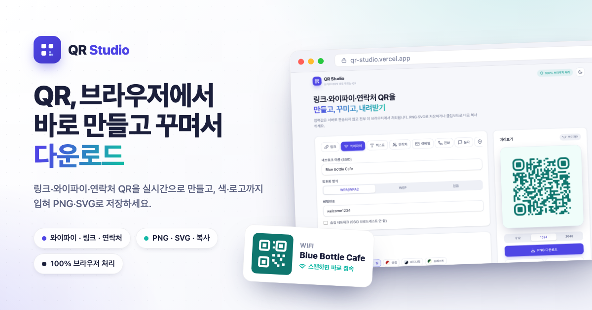
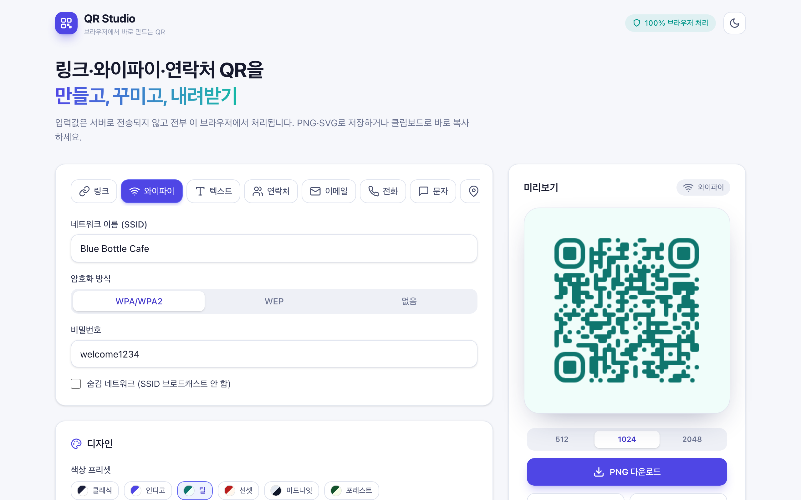

# QR Studio

브라우저에서 바로 만들고 꾸며서 내려받는 QR 코드 생성기. 링크·와이파이·연락처 등 8가지 타입을 실시간 미리보기로 만들고, 색·점 스타일·로고까지 입혀 **PNG / SVG / 클립보드**로 저장하세요. 모든 생성은 **100% 브라우저**에서 이뤄져 입력값이 서버로 전송되지 않습니다.


## 🔗 라이브 데모

**https://qr-studio-ten-kappa.vercel.app**

## ✨ 주요 기능

- 📇 **8가지 QR 타입** — 링크(URL), 텍스트, 와이파이, 연락처(vCard), 이메일, 전화, 문자(SMS), 위치(geo)
- 📶 **와이파이 QR 특화** — SSID / 비밀번호 / 암호화(WPA·WEP·없음) / 숨김 네트워크. 카페·매장·집 손님용으로 출력해 붙여두면 스캔 한 번에 접속
- ⚡ **실시간 미리보기** — 입력하는 즉시 QR이 갱신
- 🎨 **디자인 커스터마이즈** — 전경/배경 색, 6가지 색 프리셋, 점(dot) 스타일 6종, 모서리 스타일 3종, 오류정정 레벨(L/M/Q/H), 여백(quiet zone), 투명 배경
- 🖼️ **중앙 로고 삽입** — 이미지를 업로드해 가운데 배치. 로고를 넣으면 **오류정정이 자동으로 상향**되고 **로고 크기에 상한**을 둬 스캔이 깨지지 않습니다
- 💾 **내보내기** — PNG(512 / 1024 / 2048px), 인쇄용 **SVG 벡터**, 클립보드 복사
- 🔒 **프라이버시** — 비밀번호·연락처 등 민감 정보가 서버로 전송되지 않고 전부 브라우저에서 처리. 설정은 localStorage에만 저장(로고 제외)
- 🌗 **라이트 / 다크 테마**, 모바일 우선 반응형

## 🧪 스캔 정확성 검증

특수문자 이스케이프는 QR의 흔한 버그라서 두 단계로 검증했습니다.

1. **페이로드 단위 테스트(13건 통과)** — 와이파이 포맷에서 SSID/비밀번호의 `\ ; , : "` 백슬래시 이스케이프, vCard의 `; , \`·개행 처리, mailto URL 인코딩, SMSTO·geo 포맷을 모두 검증
2. **실제 디코드 검증(Playwright + jsQR)** — 렌더된 QR 캔버스를 다시 디코드해 입력값과 **정확히 일치**하는지 확인
   - URL → `https://` 자동 보정 후 일치
   - 와이파이(특수문자 포함) → `WIFI:T:WPA;S:Cafe\;Guest \"A\";P:p@ss\,word\;1;;` 로 정확히 디코드
   - **최대 크기 로고 삽입 상태에서도** URL이 깨짐 없이 디코드(오류정정 자동 상향 검증)

## 🛠️ 기술 스택

- **Vite 8** + **React 19** + **TypeScript**
- **Tailwind CSS v4** (`@tailwindcss/vite` 플러그인)
- [`qr-code-styling`](https://github.com/kozakdenys/qr-code-styling) — 커스터마이즈·로고·SVG 지원 QR 렌더링
- [`jsQR`](https://github.com/cozmo/jsQR) — 스캔 정확성 검증용 디코더

## 💻 로컬 실행

```bash
npm install
npm run dev
```

빌드:

```bash
npm run build && npm run preview
```

## 📦 QR 타입별 페이로드

| 타입 | 포맷 |
| --- | --- |
| 링크 | `https://...` (스킴 자동 보정) |
| 와이파이 | `WIFI:T:WPA;S:<ssid>;P:<pw>;H:true;;` |
| 연락처 | vCard 3.0 (`BEGIN:VCARD` … `END:VCARD`) |
| 이메일 | `mailto:<to>?subject=&body=` |
| 전화 | `tel:<number>` |
| 문자 | `SMSTO:<number>:<message>` |
| 위치 | `geo:<lat>,<lng>` |

## 📸 스크린샷



---

모든 QR 생성은 브라우저에서 처리됩니다 · 입력값은 저장·전송되지 않아요
